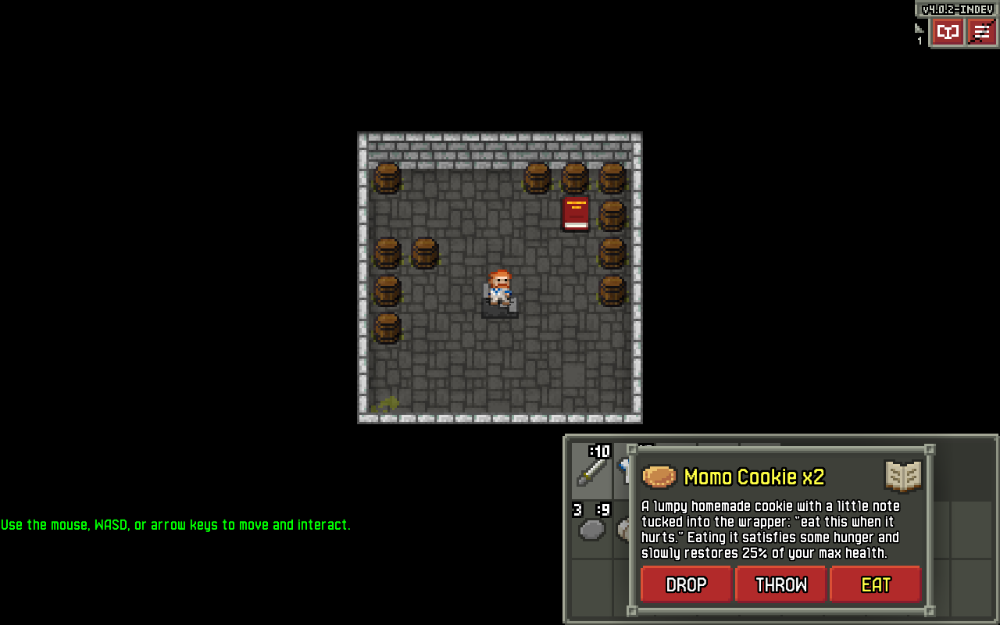

# Momo Pixel Dungeon

[Shattered Pixel Dungeon](https://github.com/00-Evan/shattered-pixel-dungeon) v4.0.2 기반 시범 모드.
원작 README는 [SPD-README.md](SPD-README.md)에 있습니다. (GPLv3)

## 바뀐 점

- **새 아이템: 모모 쿠키 (Momo Cookie)** — 모든 영웅이 2개를 들고 시작
  - 먹으면 허기를 소형 비상식량만큼(배고픔 수치의 절반) 채움
  - 최대 체력의 25%를 몇 턴에 걸쳐 회복 ("약물 공포증" 도전에서는 회복 없음)
  - 그림은 원작의 패스티 스프라이트를 재사용
- 앱 이름을 `Momo Pixel Dungeon`으로 변경 → 데스크톱 세이브 폴더가 원작과 분리됨
- 안드로이드 패키지 ID에 `.momo`를 붙여 원작과 따로 설치 가능



## 수정한 파일

| 파일 | 내용 |
|---|---|
| `core/.../items/food/MomoCookie.java` | 쿠키 아이템 (새 파일) |
| `core/.../actors/hero/HeroClass.java` | 시작 아이템에 쿠키 2개 추가 |
| `core/src/main/assets/messages/items/items.properties`, `items_ko.properties` | 영어/한국어 이름·설명 |
| `build.gradle`, `android/build.gradle` | 앱 이름, 안드로이드 패키지 ID |

## 빌드 / 실행

JDK 11 이상 필요.

```bash
./gradlew desktop:debug        # PC에서 바로 실행
./gradlew desktop:release      # 실행 가능한 jar 만들기 (desktop/build/libs/)
./gradlew android:assembleDebug  # 안드로이드 APK (Android SDK 필요)
```
